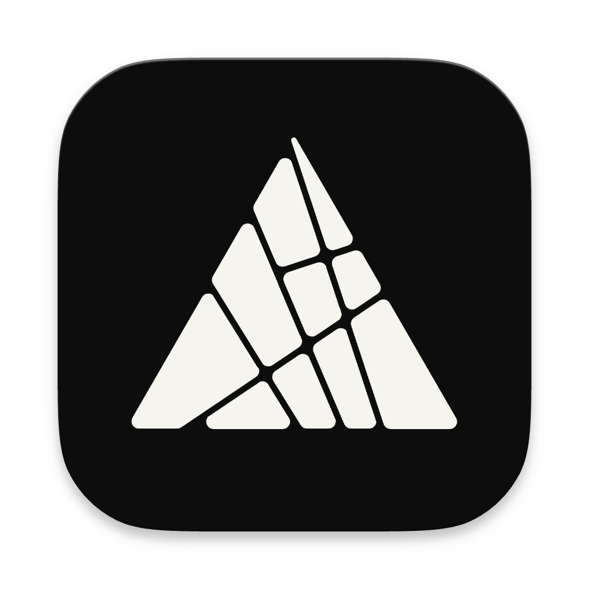
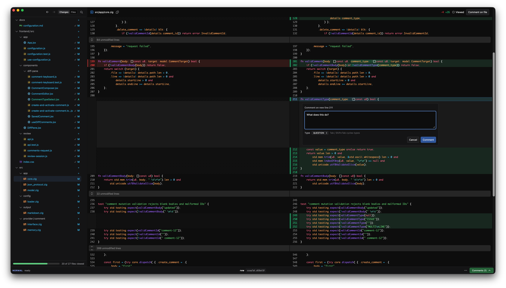

<h1 align="center">Rvw</h1>

<p align="center">
  Rvw (Review) is a code review and annotation tool designed for fast iteration with AI agents during development
</p>

<p align="center">
  
</p>

<p align="center">
  <b><a href="#installation">Installation</a></b> | <b><a href="#usage">Usage</a></b> | <b><a href="./docs">Documentation</a></b>
</p>



## Installation

Via Homebrew:

```bash
brew install --cask HayesBarber/tap/rvw
```

Or build from source (see [CONTRIBUTING.md](./CONTRIBUTING.md) for prerequisites):

```bash
npm ci --prefix frontend
zig build
```

Rvw uses a CLI to launch the GUI. After building the app, the CLI binary is located at
`zig-out/Rvw.app/Contents/MacOS/rvw-cli`, and the installed cask exposes it as the `rvw` command.

> Note that the CLI resolves the GUI path via relative locations, so don't relocate it

CLI usage is as follows:

```bash
usage: rvw [DIR] [-i | --interactive | -r RANGE | --range RANGE | -l | --last-commit | --pr NUMBER] [--log-level LEVEL]
       rvw -h | --help
       rvw -v | --version
```

See [executable configuration](./docs/configuration.md#executable-paths) for Git, GitHub CLI, and ripgrep.

## Usage

Open a Git repository with Rvw. Navigate the diff/files. Leave PR style comments. Export those comments to your clipboard. Paste to your preferred AI tool.

Use `-i` or `--interactive` to open the review-source picker after the working-tree
review against HEAD loads. The picker starts in Commits mode with no endpoints selected.

```sh
rvw -i
rvw --interactive "/path/to/repository with spaces"
rvw /path/to/repository -i --log-level debug
```

The repository path can precede or follow the option. If you omit it, Rvw uses
the current directory. Use either interactive flag once. Do not combine it with
`-r` / `--range`, `-l` / `--last-commit`, or `--pr`.

Press Escape or select Close to dismiss the picker and return to the working-tree
review. Selecting a comparison or PR loads that source. The picker opens
automatically only once per interactive process launch. Dismissal, source selection,
and reload do not open it again. A new `rvw -i` or `rvw --interactive` launch opens it again.

Rvw is built with Vim in mind. See the docs for [configuring the keybindings and user settings](./docs/configuration.md).

> Rvw stores comments in memory. Review sessions are not saved. Copy your comments before you close the app window.

## Acknowledgements

- Rvw was inspired by [tuicr](https://tuicr.dev/)
- The frontend is centered around [pierre/diffs](https://diffs.com/) and [pierre/trees](https://trees.software/)
