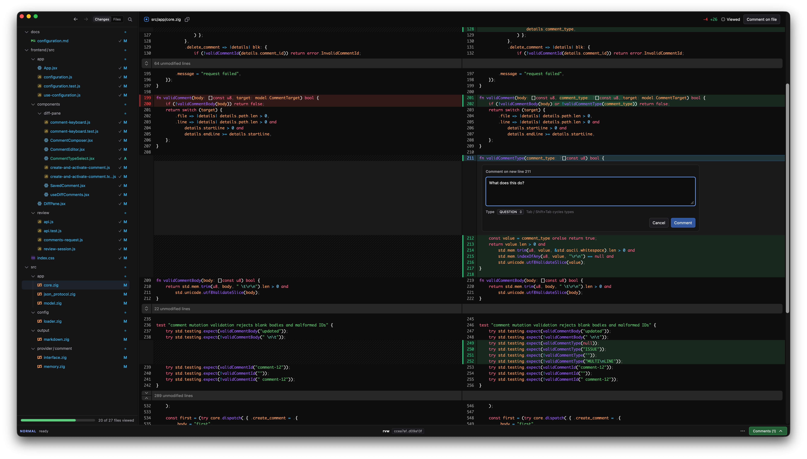

<h1 align="center">Rvw</h1>

<p align="center">
  Rvw (Review) is a code review and annotation tool designed for fast iteration with AI agents during development
</p>

<p align="center">
  
</p>

<p align="center">
  <b><a href="#installation">Installation</a></b> | <b><a href="#usage">Usage</a></b> | <b><a href="./docs">Documentation</a></b>
</p>



## Installation

Install Rvw with Homebrew.

```bash
brew install --cask HayesBarber/tap/rvw
```

## Usage

Run `rvw` to review the working tree in the current directory. Use `DIR` to open
a different repository.

```bash
usage: rvw [DIR] [-i | --interactive | -r RANGE | --range RANGE | -l | --last-commit | --pr NUMBER] [--log-level LEVEL]
       rvw -h | --help
       rvw -v | --version
```

| Option | Purpose |
| --- | --- |
| `-i`, `--interactive` | Open the review source picker at startup. |
| `-r RANGE`, `--range RANGE` | Review a commit range, for example `main..HEAD`. |
| `-l`, `--last-commit` | Compare `HEAD` with its first parent. |
| `--pr NUMBER` | Review a GitHub pull request by number. |
| `--log-level LEVEL` | Set the [log level](./docs/logging.md). |
| `-h`, `--help` | Show CLI usage. |
| `-v`, `--version` | Show the Rvw version. |

Browse the files and diffs. Add review comments. Copy the comments to the
clipboard and paste them into your AI tool.

> Rvw stores comments in memory. Copy your comments before you close the app window.

## Configuration

See the [Vim-style keybindings](./docs/configuration.md#built-in-bindings).
Use the [configuration file](./docs/configuration.md#user-configuration) to
change bindings and review settings. You can also set the
[executable paths](./docs/configuration.md#executable-paths) for Git, GitHub CLI,
and ripgrep.

## Acknowledgements

- Rvw was inspired by [tuicr](https://tuicr.dev/)
- The frontend is centered around [pierre/diffs](https://diffs.com/) and [pierre/trees](https://trees.software/)
